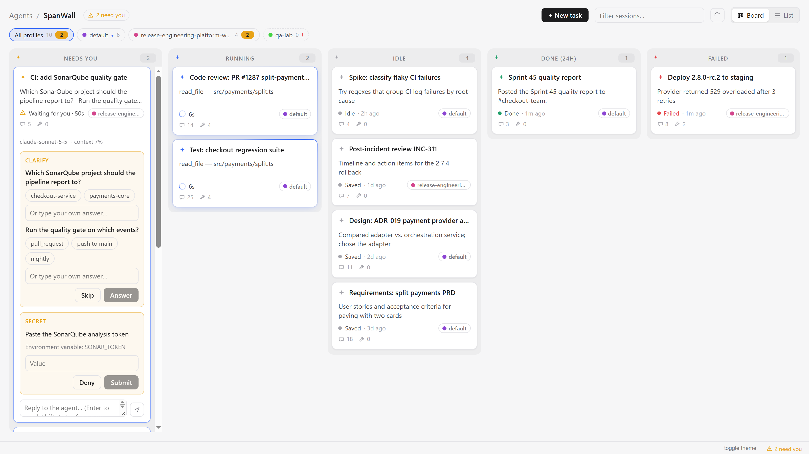
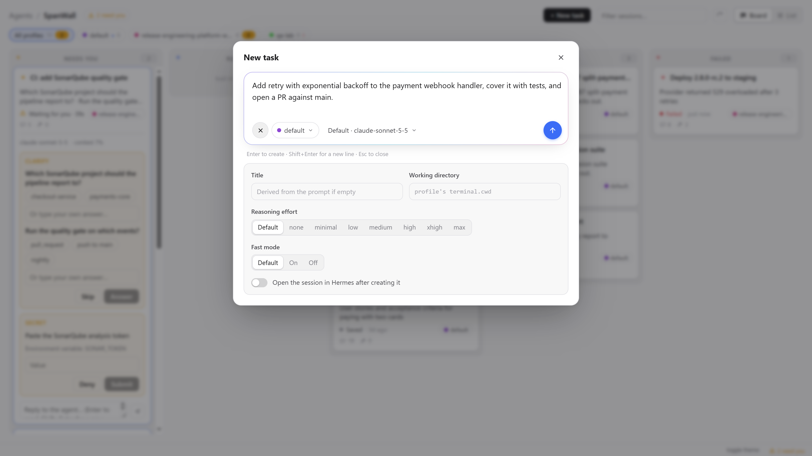

# SpanWall

> **One Kanban wall for every Hermes session, across every profile. Desktop only.**

<picture>
  <source media="(prefers-color-scheme: dark)" srcset="assets/spanwall-dark.png">
  <source media="(prefers-color-scheme: light)" srcset="assets/spanwall-light.png">
  
</picture>

Native Desktop plugin for [Hermes Agent](https://github.com/NousResearch/hermes-agent): a live
**session wall** that puts the sessions of every profile on one Kanban board, one column per state,
one card per session. Approve requests, answer questions and steer agents right from the card,
without switching profiles or windows.

Desktop-only: no backend, no build step. The whole plugin is one plain-ESM file that talks to each
profile's gateway through the Desktop plugin SDK and imports only `react` and `@hermes/plugin-sdk`.

## What you get

A **SpanWall** page in Hermes Desktop (sidebar entry, `/spanwall`) with five columns:

| Column | Holds |
|---|---|
| **Needs you** | open requests: approval, clarify, sudo password, secret |
| **Running** | a turn in flight, with the current tool and elapsed time |
| **Idle** | live sessions with nothing happening, plus recent saved sessions (opt-in) |
| **Done (24h)** | last turn finished in the past 24 hours |
| **Failed** | last turn ended in an error |

From a card:

- **Approvals**: Approve or Reject; **Session** (allow for this session) and **Always** appear when
  the request allows them.
- **Clarify, sudo, secrets**: answer or enter the value inline.
- **Chat**: read the recent conversation and reply; replying to a running session steers it.
- **Stop**: interrupt the running turn.
- **Open**: view the full session in a resizable viewer, or open it in Hermes.

Also:

- **Profiles**: filter chips per profile, a profile tag on every card, and a text filter.
- **+ New task**: create a session on any profile with its first prompt. Advanced options: model,
  reasoning effort, fast mode, working directory and title.
- **Status bar**: how many requests are waiting for you; click to open the wall.
- **Command palette**: `SpanWall: Open`, `SpanWall: New task`, `SpanWall: Refresh`.

<p align="center">
  <picture>
    <source media="(prefers-color-scheme: dark)" srcset="assets/new-task-dark.png">
    
  </picture>
</p>

## Install

Install on the **client machine**, the one running Hermes Desktop. Pick one of the two ways below.

### From the Nous plugin catalog

In Hermes Desktop: **Capabilities → Plugins → Browse**, search for **SpanWall** and click
**Install**. Or from the CLI:

```sh
hermes plugins install spanwall --enable
```

Catalog installs are pinned to a reviewed commit. Update with `hermes plugins update spanwall` (or
**Update** in **Capabilities → Plugins**), and uninstall with `hermes plugins remove spanwall`.

### From this repo

Copy `plugin/spanwall/desktop/plugin.js` to `$HERMES_HOME/desktop-plugins/spanwall/plugin.js`.

On macOS or Linux (`$HERMES_HOME` defaults to `~/.hermes`):

```sh
mkdir -p ~/.hermes/desktop-plugins/spanwall
cp plugin/spanwall/desktop/plugin.js ~/.hermes/desktop-plugins/spanwall/
```

On Windows, the install script does it:

```powershell
.\scripts\install.ps1         # copy into $HERMES_HOME\desktop-plugins\spanwall\
.\scripts\install.ps1 -Link   # symlink instead, so every save hot-reloads
```

`$HERMES_HOME` defaults to `%USERPROFILE%\.hermes`. `-Link` needs Windows Developer Mode or an
administrator shell; without it, re-run the script after each edit.

To update, pull the repo and copy the file again. To uninstall, delete
`$HERMES_HOME/desktop-plugins/spanwall/` and reload desktop plugins.

### Open it

If SpanWall does not show up, press **Ctrl+K** → **Reload desktop plugins** in Hermes Desktop. Then
open **SpanWall** from the sidebar or with **Ctrl+K** → `SpanWall: Open`.

Logs: `hermes logs gui -f`.

## Settings

**Settings → Plugins → SpanWall**:

- **Watched profiles**: tick the profiles shown on the wall. Each row is a small diagnostic: live
  and saved session counts for that profile, and an `error` flag (hover for details) when its route
  did not answer.
- **Recent saved sessions**: show up to 8 recent saved sessions per profile in the Idle column.
- **Rescan**: reload the profile list.

The wall polls every watched profile every 3 seconds, which may start that profile's backend.
Untick the profiles you don't need.

## Gateway API

Profiles come from `host.profileRoutes()`. Every RPC for a session goes through
`host.requestProfile(route, …)` of the profile that owns it.

| Purpose | SDK / RPC / event |
|---|---|
| Live sessions | `session.active_list`, polled every 3 s |
| Saved sessions, ownership | `session.list {profile}`, every 30 s |
| Pending requests | `session.events.since` → `open_requests`; falls back to `approval.pending` |
| Answers | `request.answer {id, result}`; falls back to `approval.respond` |
| Chat | `prompt.submit`, `session.steer`, `session.interrupt`, `session.history` |
| Session viewer | `session.history`; a session that isn't loaded is mounted with `session.resume {lazy: true}` |
| Context usage | `session.usage`, every 15 s; shown as "context %" on the card |
| New task | `model.options`, `session.create`, then `prompt.submit` |
| Live updates | events `message.start/delta/complete`, `tool.start/progress/complete`, `status.update`, `session.usage`, `session.title`, `error`, `request.cancel`, `approval.cancelled` |
| Re-poll triggers | events `sessions.changed`, `gateway.ready` |

## Layout

```
spanwall/
├── plugin/spanwall/
│   ├── plugin.yaml
│   └── desktop/plugin.js
├── scripts/install.ps1
├── assets/
└── LICENSE
```

## License

MIT — see [LICENSE](LICENSE).
