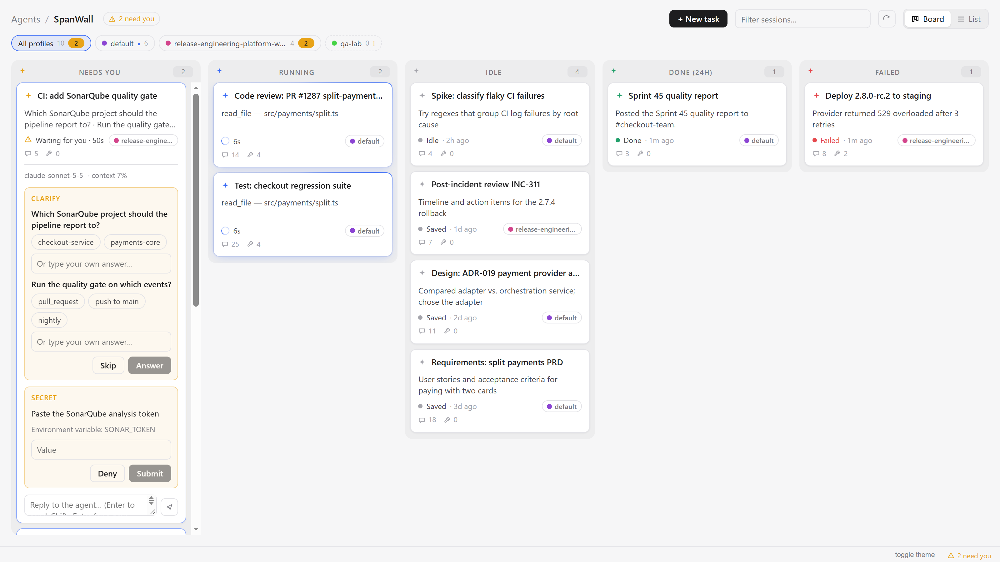
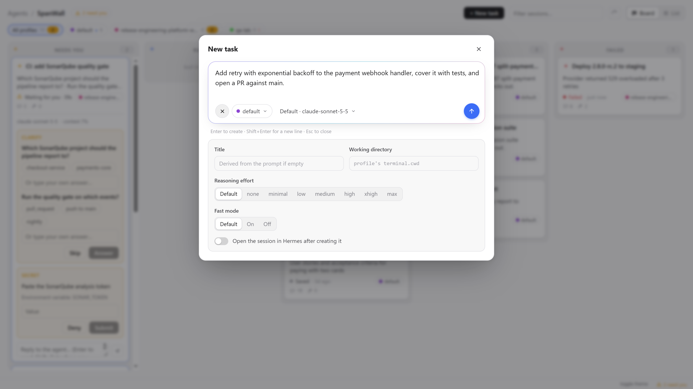

# SpanWall

> **One Kanban wall for every Hermes session, across every profile. Desktop only.**



A live **session wall** for Hermes Desktop: the sessions of every profile on one Kanban board, one
column per state, one card per session. Approve requests, answer questions and steer agents right
from the card, without switching profiles or windows.

Desktop-only: no backend, no build step. The plugin is one plain-ESM file (`desktop/plugin.js`)
that talks to each profile's gateway through the Desktop plugin SDK and imports only `react` and
`@hermes/plugin-sdk`.

## What you get

A **SpanWall** page (sidebar entry, `/spanwall`) with five columns:

| Column | Holds |
|---|---|
| **Needs you** | open requests: approval, clarify, sudo password, secret |
| **Running** | a turn in flight, with the current tool and elapsed time |
| **Idle** | live sessions with nothing happening, plus recent saved sessions (opt-in) |
| **Done (24h)** | last turn finished in the past 24 hours |
| **Failed** | last turn ended in an error |

From a card:

- **Approvals**: Approve or Reject; **Session** (allow for this session) and **Always** appear when
  the request allows them.
- **Clarify, sudo, secrets**: answer or enter the value inline.
- **Chat**: read the recent conversation and reply; replying to a running session steers it.
- **Stop**: interrupt the running turn.
- **Open**: view the full session in a resizable viewer, or open it in Hermes.

Also:

- **Profiles**: filter chips per profile, a profile tag on every card, and a text filter.
- **+ New task**: create a session on any profile with its first prompt. Advanced options: model,
  reasoning effort, fast mode, working directory and title.
- **Status bar**: how many requests are waiting for you; click to open the wall.
- **Command palette**: `SpanWall: Open`, `SpanWall: New task`, `SpanWall: Refresh`.



## Install

In Hermes Desktop: **Capabilities → Plugins → Browse**, search for **SpanWall** and click
**Install**. Or from the CLI:

```sh
hermes plugins install spanwall --enable
```

If SpanWall does not show up, press **Ctrl+K** → **Reload desktop plugins**, then open **SpanWall**
from the sidebar or with **Ctrl+K** → `SpanWall: Open`. Logs: `hermes logs gui -f`.

Update with `hermes plugins update spanwall`, uninstall with `hermes plugins remove spanwall`.

## Settings

**Settings → Plugins → SpanWall**:

- **Watched profiles**: tick the profiles shown on the wall. Each row shows live and saved session
  counts for that profile, and an `error` flag (hover for details) when its route did not answer.
- **Recent saved sessions**: show up to 8 recent saved sessions per profile in the Idle column.
- **Rescan**: reload the profile list.

## What it does with your data

- **Acts on every watched profile**, not only the active one: approving or rejecting requests,
  sending prompts, steering, interrupting and creating sessions there. Each is an explicit click;
  nothing is approved or answered automatically.
- **Sudo passwords and secrets** typed into a card go straight to the owning gateway. SpanWall does
  not store, log or display them.
- **Polling**: every watched profile's gateway every 3 seconds (usage every 15 s, profile list and
  saved sessions every 30 s). Polling a profile may start its backend; untick the profiles you
  don't need.
- **Stored in the Desktop's plugin storage**: UI preferences (watched profiles, filters, view, viewer
  size, New task options) and a 24-hour archive of finished turns (session title, profile, model,
  tools used, the error message if any, and the first 600 characters of the reply), so the Done and
  Failed columns survive a reload.
  Entries older than 24 hours are dropped.
- **No network calls** outside the Hermes gateways, and no telemetry.

## Source

[github.com/tuanpv47/spanwall](https://github.com/tuanpv47/spanwall) · MIT license
